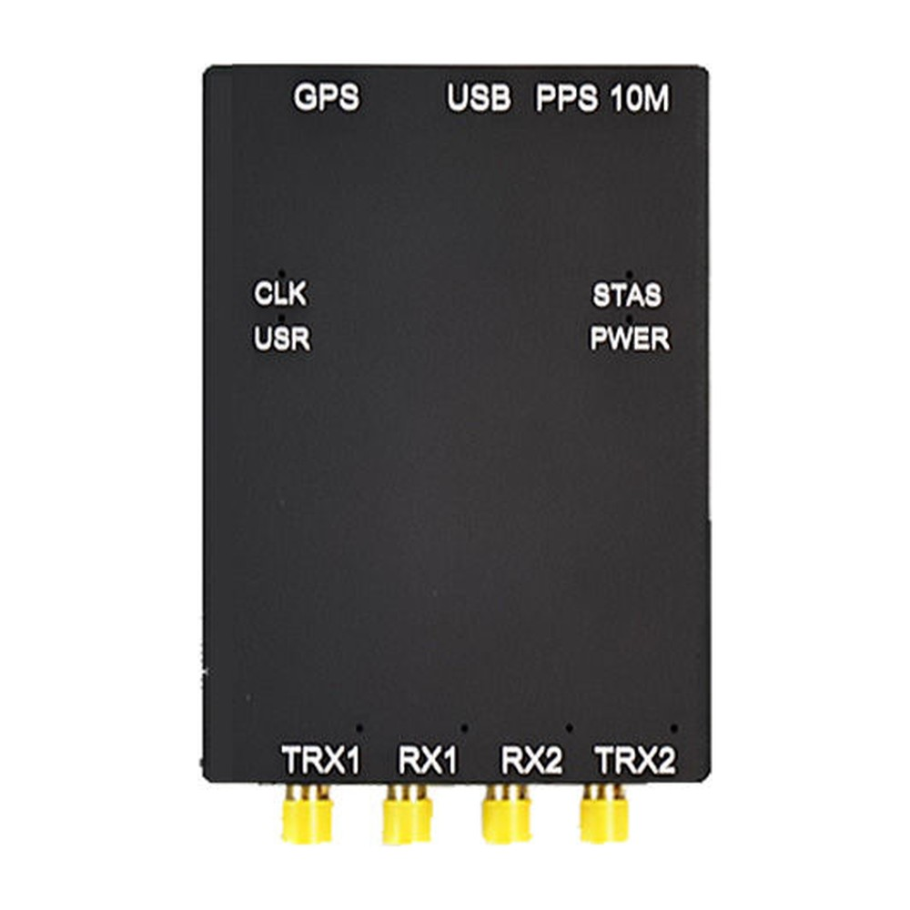
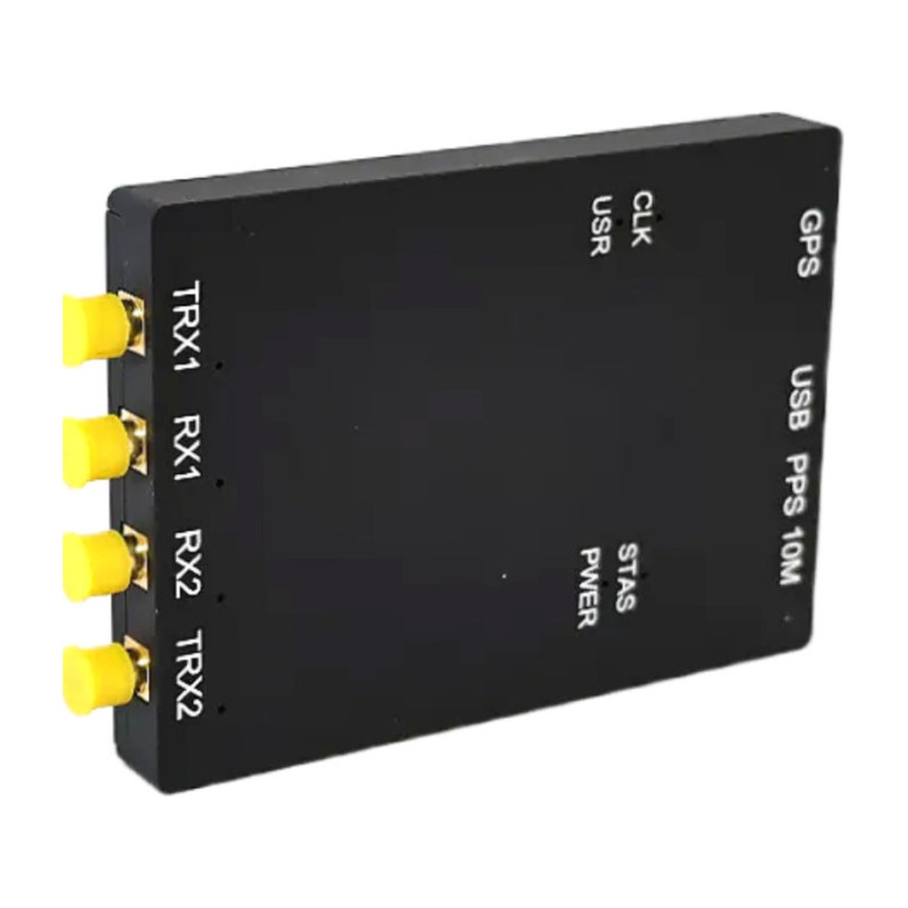

# B210-Kintex-7

Schematic, mechanical files, FPGA source project and FPGA image for the **OpenSourceSDRLab B210 Kintex-7**, a USRP B210-compatible software-defined radio that pairs the Analog Devices AD9361 RF transceiver with a Xilinx Kintex-7 FPGA.

  
  

## Product link

<https://opensourcesdrlab.com/products/b210-kintex-7>

## About the board

- RF transceiver: Analog Devices **AD9361**, 2 TX + 2 RX full duplex, 70 MHz to 6 GHz, up to 56 MHz real-time bandwidth
- RF ports: TRX1, RX1, RX2, TRX2 on SMA connectors; frequency-divided RF front end as on the original USRP B210
- FPGA: Xilinx **Kintex-7 XC7K325T** in place of the Spartan-6 of the original B210; FPGA project for **Vivado 2024.1**
- Host interface: **USB 3.0 Type-C** through a Cypress/Infineon CYUSB3014 (FX3) controller
- Timing: external **10 MHz** and **PPS** inputs (MMCX) and an **onboard GPS module** (MMCX antenna input); the GPSDO slot of the original B210 is removed
- Size: 70 × 97 × 11.5 mm
- Software: works with the Ettus Research **UHD** driver and UHD-based applications (GNU Radio, SDRangel, Gqrx and others). The board needs its own FPGA image, `usrp_b210_fpga.bin`, from this repository's Releases; the stock Ettus image does not run on it.

## Quick start

1. Install UHD from Ettus Research (Windows installer, or the `uhd-host` package on Ubuntu) and download its standard images.
2. Replace `usrp_b210_fpga.bin` in the UHD images folder with the file from the [Releases](../../releases) page.
3. Connect the board to a USB 3.0 port and run `uhd_find_devices` and `uhd_usrp_probe`.

The full steps are in the **[Quick Start Guide](docs/Quick-Start-Guide.md)** ([PDF](docs/Quick-Start-Guide.pdf)).

## User manual

The detailed user manual (Windows and Ubuntu setup, SDRangel, URH, GNU Radio, SDR# and Gqrx) is on our blog: <https://blog.opensourcesdrlab.com/archives/kintex-7-usrp-b210-user-manual>

## Repository layout

| Path | Contents |
|---|---|
| `hardware/B210-Kintex-7_Schematic.pdf` | Board schematic, revision V2.1 (PDF) |
| `hardware/mechanical/` | Board outline (DWG) and 3D model (STEP) |
| `fpga/` | Vivado 2024.1 project of the FPGA image (`B210_Project_Firmwire.xpr`), based on the Ettus Research USRP B200/B210 FPGA design |
| `examples/gnuradio/` | GNU Radio Companion example flowgraphs |
| `docs/` | Quick Start Guide (Markdown and PDF) |
| `images/` | Product photos |

## Downloads (Releases)

Large and prebuilt files are attached to the [Releases](../../releases) page instead of being stored in the repository:

| File | Contents |
|---|---|
| `B210-Kintex-7_FPGA-image_Vivado2024.1.zip` | `usrp_b210_fpga.bin` for this board (FPGA image V2.0, built 2026-10-22 from `fpga/`) |
| `SHA256SUMS.txt` | SHA-256 checksums of the files above |

Check a download with `shasum -a 256 -c SHA256SUMS.txt` (macOS / Linux) or `certutil -hashfile <file> SHA256` (Windows).

## Licence

Files created by OpenSourceSDRLab are released under the [Apache License 2.0](LICENSE). The FPGA design in `fpga/` is derived from the Ettus Research USRP FPGA code in UHD and remains under the GNU LGPL v3 ([fpga/LICENSE.md](fpga/LICENSE.md)); Xilinx IP configuration files remain under Xilinx/AMD terms. See [NOTICE.md](NOTICE.md) for the file-by-file list.

## Support

- Email: support@opensourcesdrlab.com
- Forum: <https://forum.opensourcesdrlab.com>
- Discord: <https://discord.gg/nnxY6DkmvT>
- Blog and user manuals: <https://blog.opensourcesdrlab.com>

---
© 2026 OpenSourceSDRLab. All rights reserved. · <a href="https://www.opensourcesdrlab.com">www.opensourcesdrlab.com</a>
